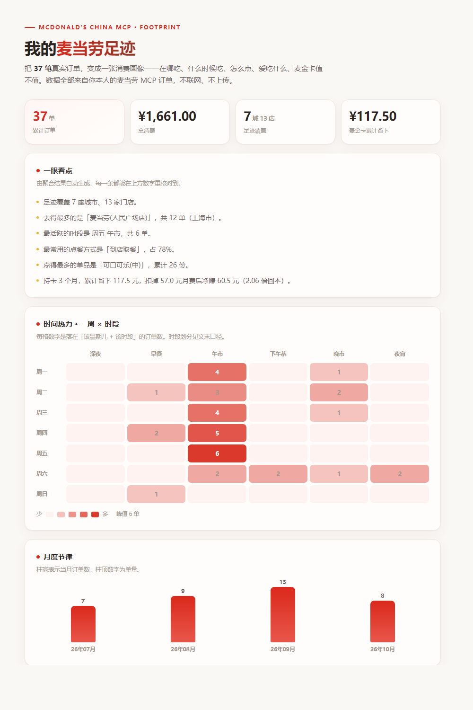
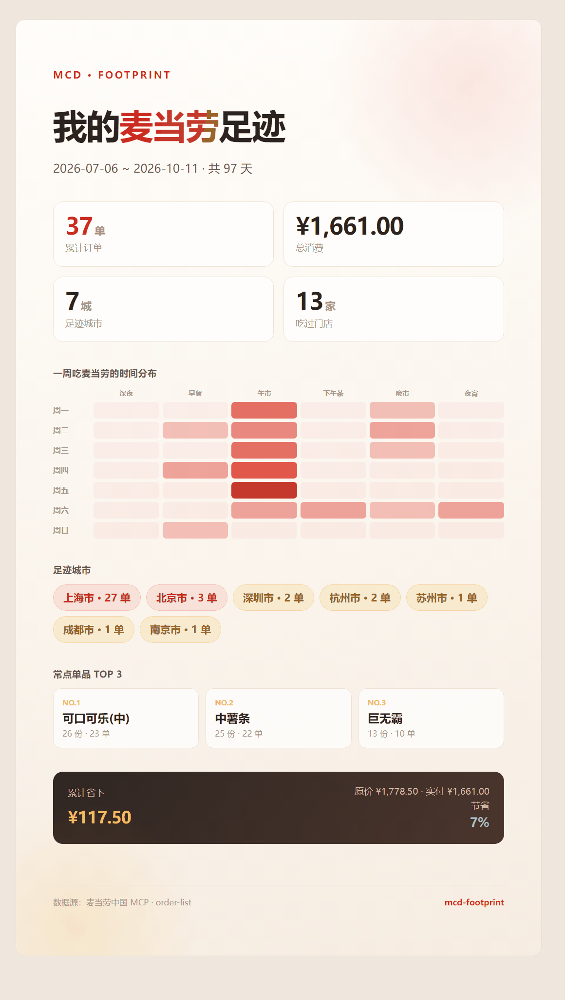

<div align="center">

# 麦麦足迹 · mcd-footprint

**把你在麦当劳的每一单，变成一张消费画像。**

在哪吃 · 什么时候吃 · 怎么点 · 爱吃什么 · 麦金卡值不值

[](LICENSE)


</div>

<p align="center">
  
</p>

<p align="center"><sub>上图由仓库自带的脱敏示例数据生成，不含任何真实订单。</sub></p>

---

## 这是什么

一句话：**Spotify Wrapped，但是你的麦当劳。**

麦当劳中国 MCP 已经开放历史订单查询能力。`mcd-footprint` 把这些订单拉下来，
在你的**本机**聚合成五个维度的消费画像，渲染成一份自包含 HTML 报告，外加一张可以发出去的分享卡。

> 🔒 **数据不出本机。** 不上传、不联网、不留档。订单是个人消费记录，本项目只做本地计算。

它和"探店手账"是两种东西：手账靠你**手工记录**，`mcd-footprint` 靠**你已有的订单自动分析**。

---

## 五个维度 + 一本账

| 维度 | 看什么 |
|---|---|
| 🕐 **时间热力** | 一周 × 时段的订单矩阵——你通常什么时候吃麦当劳 |
| 📅 **月度节律** | 各月消费起伏，一眼看出哪个月吃得凶 |
| 🛍 **点餐方式** | 到店取餐 / 麦乐送 / 得来速 / 堂食外带 / 企业团餐，占比分布 |
| 🍔 **品类结构** | 钱花在汉堡、饮料、冰激凌还是咖啡上 |
| 📍 **城市足迹** | 吃过哪些城市、哪些区、哪些店，哪家去得最勤 |
| 💳 **麦金卡账本** | 省下的钱 vs 月费成本——这张卡到底值不值 |

麦金卡那一项会同时给出**节省额、月费成本、持有月数**三个数字，
让你自己就能验算"回本了没有"，而不是只看到一个孤零零的"省了 XX 元"。

---

## 分享卡

<p align="center">
  
</p>

一张 1080×1920 的竖版卡片（9:16，手机全屏比例），打开即可截图 / 长按保存。
报告和卡片都是**单文件 HTML**，内联样式、零外部依赖，离线也能打开。

---

## 快速开始

### 1. 申请麦当劳 MCP Token

打开 **<https://open.mcd.cn/mcp>** → 右上角「登录」（手机号验证）→「控制台」→「激活」→ 一键复制。

免费，无门槛。每人一个 Token，**每分钟 600 次请求**。

### 2. 接入 MCP

在你的 MCP 客户端（WorkBuddy / Cursor / Cherry Studio / Trae 等）配置里加上：

```json
{
  "mcpServers": {
    "mcd-mcp": {
      "type": "streamablehttp",
      "url": "https://mcp.mcd.cn",
      "headers": {
        "Authorization": "Bearer ${MCD_MCP_TOKEN}"
      }
    }
  }
}
```

把 `${MCD_MCP_TOKEN}` 换成你的 Token，或用环境变量注入（**推荐**，避免 Token 进入任何文件）。

### 3. 用起来

在对话里直接说：

> 看看我的麦当劳消费记录，生成消费画像

> 我这张麦金卡办得值不值？省回来没有？

> 我经常吃哪家店，一般什么时间吃？

Skill 会自动拉取、聚合、渲染，并把报告和分享卡交给你。

---

## 不用 Token 也能先看效果

仓库里带了一份**完整的脱敏示例数据**（37 单、7 城、13 店）：

```bash
# 1. 聚合
python scripts/footprint_aggregate.py \
  --input examples/sample-orders.json \
  --output examples/sample-footprint.json

# 2. 渲染报告与分享卡
python scripts/render_report.py \
  --input examples/sample-footprint.json \
  --output examples/sample-report.html \
  --card-output examples/sample-card.html
```

或者直接双击打开仓库里的 `examples/sample-report.html`。

---

## 项目结构

```
mcd-footprint/
├── SKILL.md                          # ★ Skill 定义：触发边界、工作流、决策点
├── references/
│   ├── mcd-tools.md                  # 依赖的 MCP 工具与字段提取要点
│   ├── playbooks.md                  # 调用序列与失败分支
│   ├── metrics.md                    # ★ 五维口径定义：每个数字怎么算出来的
│   └── pitfalls.md                   # 实测踩坑清单
├── scripts/
│   ├── footprint_aggregate.py        # 五维聚合器
│   └── render_report.py              # HTML 报告 + 分享卡渲染器
├── examples/                         # 脱敏示例数据与生成物
├── docs/                             # README 预览图
├── MCP_INTEGRATION.md                # MCP 接入说明（工具、流程、业务价值）
├── CONTEST_DECLARATION.md            # 参赛声明
├── mcp-config.example.json           # 脱敏配置示例
└── workbuddy.md                      # WorkBuddy 开发对话记录
```

---

## 关于数据，把话说清楚

这个项目有三件事**做不到**，而且不会假装做得到：

| 限制 | 原因 | 项目怎么处理 |
|---|---|---|
| **拿不到门店经纬度** | 官方门店查询接口不返回坐标 | 地点维度只做到「城市 → 区 → 门店」层级，不画地理坐标 |
| **只有近期订单** | 官方口径：*"近期订单不是全年完整历史"* | 样本 < 15 单时主动降级告警，不把"近期分布"说成"长期习惯" |
| **品类是启发式归类** | 官方不提供商品分类字段 | 归类规则公开在脚本常量区，明确标注为**非官方分类** |

除此之外：

- 订单时间字段**不含时区**，统一按 **UTC+8** 解释，并在报告里显式声明；
- 接口金额单位是**分**，报告统一换算为**元**；
- 每一单都会做**小计校验**（明细加总 vs 声明小计），对不上就在报告里告警——**不掩盖**。

完整口径定义见 [`references/metrics.md`](references/metrics.md)。
任何一条结论都能回溯到对应规则。

---

## 常见问题

<details>
<summary><b>我的订单数据会被上传吗？</b></summary>

不会。聚合与渲染全部在本机完成，脚本不发起任何网络请求。
生成物是本地 HTML 文件，`.gitignore` 已排除真实订单快照目录。
</details>

<details>
<summary><b>为什么不做成地图上的热力点？</b></summary>

因为**官方接口不返回门店经纬度**。要画出真实的地理热力图，必须自建全国门店坐标库——
那是另一个量级的工程量。本项目选择诚实地把地点维度做到行政区划层级，
而不是用"城市中心点"假装成"门店位置"。
</details>

<details>
<summary><b>为什么我的订单只有十几条？</b></summary>

官方 `order-list` 只返回**近期**订单。这是接口能力边界，不是 bug。
样本偏小时，项目会主动提示"分布结论稳定性有限"。
</details>

<details>
<summary><b>它会替我做任何操作吗？</b></summary>

不会。本 Skill 只调用只读工具（`now-time-info` / `order-list` / `query-order`），
**不会下单、取消、领券、兑换或预约**。这是项目的红线。
</details>

<details>
<summary><b>「麦金卡值不值」是怎么算的？</b></summary>

累计节省（Σ 用卡订单的优惠金额）− 持有月数 × 月费（默认 19 元/月）。
三个数字全部展示，结论可自行验算。
</details>

---

## 参赛信息

本项目为 **2026 麦当劳程序员创意开发大赛**参赛作品，基于麦当劳中国官方 MCP Server 开发。

- 官方活动仓库：[M-China/mcd-developer-innovation-challenge](https://github.com/M-China/mcd-developer-innovation-challenge)
- MCP 服务：<https://open.mcd.cn/mcp>
- 本项目**非**麦当劳官方产品，与麦当劳中国无隶属关系
- 麦当劳、「麦当劳」及金拱门标识为麦当劳公司的注册商标

## License

[MIT](LICENSE)
