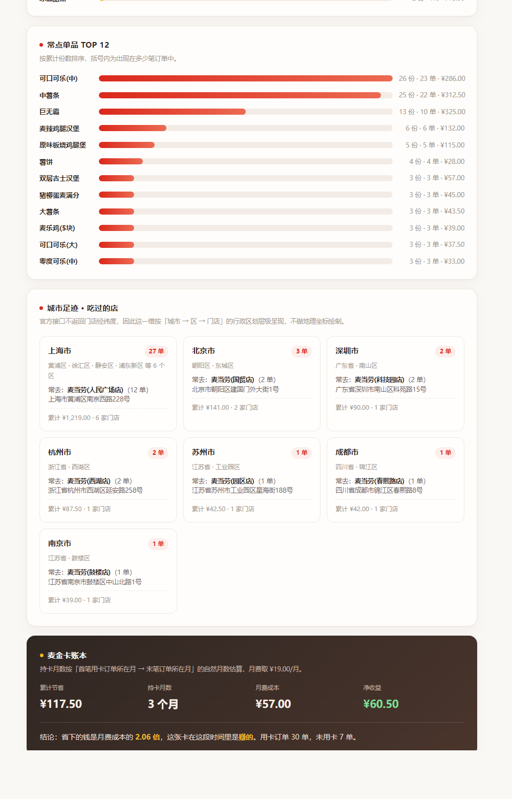

<p align="center">
  
</p>

<div align="center">

# 麦麦足迹 · mcd-footprint

### Spotify Wrapped，但是你的麦当劳。

不用手工记，不用翻截图 —— 把你**已有的订单**直接变成一张回忆地图。


</div>

<p align="center">  
<b>5 个维度</b>　·　<b>1 份 HTML 报告</b>　·　<b>0 次上传</b>  
</p>

---

## 三秒看到效果

**最快的一种，零安装**：克隆仓库后直接双击 `examples/sample-report.html`，浏览器打开就是完整报告，离线可用、不联网。

```bash
git clone https://github.com/jiner-2/mcd-footprint.git
```

示例数据是**完整脱敏**的 37 单 / 7 城 / 13 店，纯属虚构，用来演示报告长什么样。  
想看自己真实数据长什么样，走下面「安装」三步，拉你自己的订单重跑一遍。

---

## 这是什么

麦当劳中国 MCP 已经开放历史订单查询。`mcd-footprint` 把这些订单拉下来，在**本机**聚合成五个维度的消费画像，渲染成自包含 HTML 报告 + 一张分享卡。

> 🔒 **数据不出本机。** 不上传、不联网、不留档。订单是个人消费记录，本项目只做本地计算，脚本本身不发起任何网络请求。

**它和「探店手账」是两种东西**：手账靠你手工打卡记录，`mcd-footprint` 靠你已有的订单自动分析 —— 你什么都不用做，只要过去在麦当劳点过单。

**它和「人格测试」也是两种东西**：这里没有编造的人设，每个数字都能回溯到一条计算规则（见 [`references/metrics.md`](references/metrics.md)），你可以自己加总核对。

---

## 五个维度 + 一本账

| 维度           | 看什么                                 |
| ------------ | ----------------------------------- |
| 🕐 **时间热力**  | 一周 × 时段的订单矩阵 —— 你通常什么时候吃麦当劳         |
| 📅 **月度节律**  | 各月消费起伏，一眼看出哪个月吃得凶                   |
| 🛍 **点餐方式**  | 到店取餐 / 麦乐送 / 得来速 / 堂食外带 / 企业团餐，占比分布 |
| 🍔 **品类结构**  | 钱花在汉堡、饮料、冰激凌还是咖啡上                   |
| 📍 **城市足迹**  | 吃过哪些城市、哪些区、哪些店，哪家去得最勤               |
| 🧾 **优惠账本**  | 原价多少、实付多少、省下的钱来自哪几张券              |

<p align="center">  
    
</p>

<p align="center"><sub>报告全貌：洞察摘要、时间热力矩阵、月度节律、点餐方式、品类结构、城市足迹、优惠账本、口径声明</sub></p>

优惠账本那一项会同时给出**折前原价、实际支付、累计省下、节省比例**四个数字，外加每张券的贡献排行——原价减省下必须等于实付，对不上就说明映射错了。省下的钱到底来自哪，可以逐笔回溯。

> **关于麦金卡**：最初想做的是「麦金卡账本」，算出办卡到底回本没有。拿到真实 Token 后发现
> **接口根本不返回持卡 / 权益字段**——对 20 份真实返回全量搜索 `card` / `麦金` / `会员` / `vip`，零命中。
> 这个维度不是数据少，是没有数据。所以换成了同位置、同样能回答「值不值」、但每个数字都真实可算的优惠账本。
> 缘由写在 [`references/pitfalls.md`](references/pitfalls.md) 第 7 条。

---

## 适合谁用

| 你是                        | 为什么值得跑一次                     |
| ------------------------- | ---------------------------- |
| **每周吃 3 次以上的重度用户**        | 样本够厚，时间热力和品类结构才有信息量          |
| **爱用券、爱蹲优惠的人**           | 优惠账本会告诉你省下的钱到底来自哪几张券，哪张最值     |
| **经常出差、跨城吃的人**            | 城市足迹会画出你自己都没意识到的那张「出差地图」     |
| **在写年度总结、消费复盘的人**         | 分享卡可以直接用，不用再整理一遍账单           |
| **想学 MCP + Skill 写法的开发者** | 一个只读、本地、零依赖的完整参考实现，代码 4k 行以内 |

不太适合：一年只吃两三次的人（官方 `order-list` 只返回近期订单，实测一次 10 条，样本太少，报告会主动提示「分布结论稳定性有限」）。

---

## 安装

### 1. 申请麦当劳 MCP Token

打开 **<https://open.mcd.cn/mcp>** → 右上角「登录」（手机号验证）→「控制台」→「激活」→ 一键复制。

免费，无门槛。每人一个 Token，**每分钟 600 次请求**。

### 2. 放进 WorkBuddy

把本仓库放进 WorkBuddy 的 skills 目录：

```bash
git clone https://github.com/jiner-2/mcd-footprint.git \
  ~/.workbuddy/skills/mcd-footprint
```

> Windows 下即 `C:\Users\<你的用户名>\.workbuddy\skills\mcd-footprint`。

### 3. 接入 MCP

在 MCP 客户端（WorkBuddy / Cursor / Cherry Studio / Trae 等）的配置里加上：

```json
{
  "mcpServers": {
    "mcd-mcp": {
      "type": "streamablehttp",
      "url": "https://mcp.mcd.cn",
      "headers": {
        "Authorization": "Bearer ${MCD_MCP_TOKEN}"
      }
    }
  }
}
```

把 `${MCD_MCP_TOKEN}` 换成你的 Token，或用环境变量注入（**推荐**，避免 Token 进入任何文件）。  
WorkBuddy 用户可直接用仓库里的 [`mcp-config.example.json`](mcp-config.example.json)，在「自定义连接器 → 配置 MCP」粘贴。

### 4. 环境

Python 3.9+，**不需要任何第三方库** —— 只用标准库。

---

## 使用示例

装好之后，在对话里直接说话就行：

> 看看我的麦当劳消费记录，生成消费画像

> 我这一年优惠券到底省了多少钱？哪张最值？

> 我经常吃哪家店，一般什么时间吃？

> 帮我生成一张能发朋友圈的分享卡

Skill 会自动拉取订单 → 聚合五维 → 渲染报告与分享卡 → 把文件路径交给你。

**想自己手动跑一遍（用真实订单）**，就三步：

```bash
# 1. 把 MCP 的 order-list / query-order 返回存成文件（或整个目录）
#    先探一下官方到底返回了哪些字段，再规范化
python scripts/normalize_orders.py --input raw/ --dump-keys
python scripts/normalize_orders.py --input raw/ --output orders.json

# 2. 聚合五维
python scripts/footprint_aggregate.py --input orders.json --output footprint.json

# 3. 渲染报告与分享卡
python scripts/render_report.py --input footprint.json \
  --output report.html --card-output card.html
```

`normalize_orders.py` 按结构特征识别订单对象（有时间 + 有明细即视为订单），
不依赖固定外层包装；金额单位按每个文件独立判定，并自动去掉 `order-list` 与
`query-order` 的重复单。字段名万一变了，补进脚本顶部的 `ALIASES` 即可，不用改逻辑。

**不用 Token 也能先跑**（仓库自带脱敏样例）：

```bash
# 1. 聚合五维
python scripts/footprint_aggregate.py \
  --input examples/sample-orders.json \
  --output examples/sample-footprint.json

# 2. 渲染报告与分享卡
python scripts/render_report.py \
  --input examples/sample-footprint.json \
  --output examples/sample-report.html \
  --card-output examples/sample-card.html
```

---

## 分享卡

<p align="center">  
    
</p>

<p align="center"><sub>↑ 一张 1080×1920 的分享卡，自动生成 · 数据全程不出本机</sub></p>

报告和分享卡都是**单文件 HTML**，内联样式、零外部依赖、离线可打开。分享卡按 1080×1920（9:16 手机全屏）排版，打开即整卡，直接截图或长按保存。

<p align="center">  
    
</p>

---

## 项目结构

```
mcd-footprint/
├── SKILL.md                          # ★ Skill 定义：触发边界、工作流、决策点
├── references/
│   ├── mcd-tools.md                  # 依赖的 MCP 工具与字段提取要点
│   ├── playbooks.md                  # 调用序列与失败分支
│   ├── metrics.md                    # ★ 五维口径定义：每个数字怎么算出来的
│   └── pitfalls.md                   # 实测踩坑清单
├── scripts/
│   ├── normalize_orders.py           # MCP 原始返回 → 规范化订单（含字段探测）
│   ├── footprint_aggregate.py        # 五维聚合器
│   └── render_report.py              # HTML 报告 + 分享卡渲染器
├── examples/                         # 脱敏示例数据与生成物
├── docs/                             # README 预览图
├── MCP_INTEGRATION.md                # MCP 接入说明（工具、流程、业务价值）
├── CONTEST_DECLARATION.md            # 参赛声明
├── mcp-config.example.json           # 脱敏配置示例
└── workbuddy.md                      # WorkBuddy 开发对话记录
```

---

## 关于数据，把话说清楚

这个项目有三件事**做不到**，而且不会假装做得到：

| 限制           | 原因                    | 项目怎么处理                            |
| ------------ | --------------------- | --------------------------------- |
| **拿不到门店经纬度** | 官方门店查询接口不返回坐标         | 地点维度只做到「城市 → 区 → 门店」层级，不画地理坐标     |
| **只有近期订单**   | 官方口径：*"近期订单不是全年完整历史"* | 样本 < 15 单时主动降级告警，不把「近期分布」说成「长期习惯」 |
| **品类是启发式归类** | 官方不提供商品分类字段           | 归类规则公开在脚本常量区，明确标注为**非官方分类**       |

除此之外：

- 订单时间字段**不含时区**，统一按 **UTC+8** 解释，并在报告里显式声明；
- 订单接口返回的金额是**元**且为字符串（`"14.9"` 就是 14.9 元），内部统一折算为分计算、展示时换回元；
- 门店地址里**没有城市名**，城市优先从地址解析，解析不出就用门店名前缀匹配内置城市表，都拿不到就留空；
- 每一单都会做**小计校验**（明细加总 vs 声明小计），对不上就在报告里告警 —— **不掩盖**。

完整口径定义见 [`references/metrics.md`](references/metrics.md)。任何一条结论都能回溯到对应规则。

---

## 常见问题

<details>

<summary><b>我的订单数据会被上传吗？</b></summary>

不会。聚合与渲染全部在本机完成，脚本不发起任何网络请求。  
生成物是本地 HTML 文件，`.gitignore` 已排除真实订单快照目录。

</details>

<details>

<summary><b>为什么不做成地图上的热力点？</b></summary>

因为**官方接口不返回门店经纬度**。要画出真实的地理热力图，必须自建全国门店坐标库 ——  
那是另一个量级的工程量。本项目选择诚实地把地点维度做到行政区划层级，  
而不是用「城市中心点」假装成「门店位置」。

</details>

<details>

<summary><b>为什么我的订单只有十几条？</b></summary>

官方 `order-list` 只返回**近期**订单。这是接口能力边界，不是 bug。  
样本偏小时，项目会主动提示「分布结论稳定性有限」。

</details>

<details>

<summary><b>它会替我做任何操作吗？</b></summary>

不会。本 Skill 只调用只读工具（`now-time-info` / `order-list` / `query-order`），  
**不会下单、取消、领券、兑换或预约**。这是项目的红线。

</details>

<details>

<summary><b>为什么没有「麦金卡值不值」这个维度？</b></summary>

因为接口给不了。原本计划算这个维度，拿到真实 Token 后对 20 份真实返回全量搜索
`card` / `麦金` / `会员` / `vip`，**零命中**——两个订单接口都不返回任何持卡标识。

硬做只能编，所以换成了**优惠账本**：原价、实付、省下的钱、每张券的贡献。
这几个数字全部来自返回字段，能逐笔回溯，比一个编出来的「回本倍数」有用得多。

</details>

---

## 参赛信息

本项目为 **2026 麦当劳程序员创意开发大赛**参赛作品，基于麦当劳中国官方 MCP Server 开发。

- 官方活动仓库：[M-China/mcd-developer-innovation-challenge](https://github.com/M-China/mcd-developer-innovation-challenge)
- MCP 服务：<https://open.mcd.cn/mcp>
- MCP 接入与使用遵循[《麦当劳 MCP 服务规则》](https://cdn.mcd.cn/cms/pages/MCPServerRules.html)
- 本项目**非**麦当劳官方产品，与麦当劳中国无隶属关系
- 麦当劳、「麦当劳」及金拱门标识为麦当劳公司的注册商标

## License

[MIT](LICENSE)
